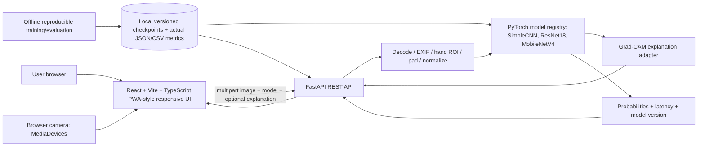

# GestureLab AI — Architecture & Assignment 2 technical specification

**Status:** implementation design (not an assertion that the application, trained models, or measured metrics already exist).

## 1. Source-of-truth / what the supplied materials actually contain

- Assignment 2 requires: continuation of A1 topic and dataset; one or two modern CV add-ons; working upload/camera → classification → genuine visual explanation; accuracy/F1, training curves, ablation; measured latency and environment; ethical disclosure; report of 6–8 pages, 3–5 minute demo video, repository, app URL or local run guide.
- Submission deadline: **2026-11-07 23:59 Asia/Almaty**; oral practice-session defense also required.
- Supplied `ready_dataset.zip`: **400 JPGs**, all valid **224×224 RGB**, classes `fist`, `open_palm`, `peace`, `thumbs_up`. Each class: **70 train / 15 val / 15 test**. No identical-byte duplicates or repeated basenames across splits were detected. This does **not** establish separation by person or rule out perceptual near-duplicates.
- Supplied `notebook.ipynb`: A1 `SimpleCNN` and `ResNet18` frozen-backbone feature-extraction experiment; A1 preprocessing uses 224×224 square hand crops with mid-gray (128,128,128) padding and ImageNet normalization; model outputs are 4-way logits. Contains moderate augmentation (+4 train variants per original), train and eval, but `RUN_TRAINING=False` and it expects directories `ready_dataset_augmented`, `ready_dataset_strong`, `results_moderate`, `results_strong` that **are not included** in the supplied three files. No `.pt` model weights or recorded result tables are supplied. Do not invent them.
- Inference must preserve the **same crop/pad/normalization policy** as corresponding training run. A webcam image must locate or guide the hand ROI, then pad/rescale. Never blindly classify an entire camera frame and present the score as if trained on the same distribution.

## 2. SOTA strategy

Primary modern method: **MobileNetV4-Conv-Small** transfer learning, pretrained weights from the exact timm model identifier `mobilenetv4_conv_small.e3600_r256_in1k` (or the equivalent `hf_hub:timm/mobilenetv4_conv_small.e3600_r256_in1k` after runtime validation). Peer-reviewed source: Qin et al., *MobileNetV4: Universal Models for the Mobile Ecosystem*, ECCV 2024, https://www.ecva.net/papers/eccv_2024/papers_ECCV/html/5647_ECCV_2024_paper.php. Public model documentation: https://huggingface.co/timm/mobilenetv4_conv_small.e3600_r256_in1k.

Why: modern efficient CV architecture, direct head-to-head against two original A1 baselines, lower computational load than heavy T2V generation on a low-performance laptop. The assignment explicitly permits another modern SOTA method, although it separately requests a relevant Neurohive citation. **Do not invent a Neurohive article for MobileNetV4.** Cite its primary paper and include the assignment's referenced Neurohive hand-gesture article or obtain teacher confirmation that a primary-paper citation suffices. ArtAug and Step-Video-T2V are *not* implemented simply by applying ordinary brightness transforms; never make that claim.

Optional stretch only **after** passing all acceptance gates: DINOv2 ViT-S frozen visual embeddings + linear classifier, particularly to provide a nearest-neighbor gallery. https://github.com/facebookresearch/dinov2 and https://huggingface.co/timm/vit_small_patch14_dinov2.lvd142m. A stretch feature must not delay the required app, report, or video.

Controlled experiments, fixed split and seed:
- A1 SimpleCNN: reproduce training and evaluation from notebook.
- A1 ResNet18 frozen backbone: reproduce training and evaluation from notebook.
- MobileNetV4 baseline adaptation: frozen pretrained feature backbone + trained 4-class head, then unfreeze only if hardware/performance permit. Log whether the backbone was frozen.
- MobileNetV4 **ablation**: training without data augmentation vs moderate augmentation, identical split/evaluation and reasonable controlled hyperparameters. Validation chooses settings; held-out test is for final reported performance, not repeated tuning. Never augment validation/test for standard score.
- Evaluate accuracy, macro precision/recall/F1, per-class F1, confusion matrices, history curves, inference timing on a named CPU/GPU. Deterministic controlled stress-test evaluation (lighting, blur, partial occlusion where meaningful) reported **separately** from clean test accuracy. Stress transforms are not ArtAug or generative outputs.

## 3. High-level topology



No database, accounts, or paid APIs needed. The only model-related network dependency is an **explicit first-time download of pretrained weights during preparation/training**. App inference must use local checkpoints and not call a generative API.

## 4. Technology choices

- **Frontend:** React, TypeScript, Vite, Tailwind CSS, shadcn/ui (optional if it works with selected versions), Recharts, Lucide; Vitest + React Testing Library; Playwright for browser E2E if installed.
- **Backend:** Python 3.11+, FastAPI, Pydantic, Pillow, PyTorch/torchvision, timm, scikit-learn, numpy, matplotlib; pytest + httpx. Optional MediaPipe is limited to ROI localization if installation/hardware permit (not to fabricate gesture labels).
- **Inference:** dynamically select the correctly versioned model; `no_grad` inference for ordinary prediction; explicit gradient-enabled path for Grad-CAM. CPU is a supported default, CUDA/MPS optional.
- **Persistence:** immutable checkpoints, manifest metadata, per-run config, CSV/JSON/PNG reports stored on disk; no user image retention by default.
- **Deployment:** documented localhost startup using venv + npm, plus optional Docker compose after local path works. Webcam is supported on `localhost` or HTTPS only; permission error UI required.

## 5. Endpoints and response contracts

| HTTP | Endpoint | Meaning |
|---|---|---|
| GET | `/api/health` | live service, active devices, loaded/unavailable models, not a false-green readiness check |
| GET | `/api/models` | available trained models, class mapping, metadata, checkpoint hash |
| POST | `/api/predict` | `multipart/form-data`: `file`, `model_id`, `explain`; returns label, all probabilities, latency, model/version, device, explanation PNG if successful, and clear errors otherwise |
| GET | `/api/experiments` | actual measured comparison and ablation data or explicit unavailable state |
| GET | `/api/experiments/{run_id}` | run settings, clean/stress scores, history, confusion matrix, timestamps |

Use a clear typed schema. Error cases: missing weights, invalid JPEG, image over 10 MB, wrong format, no visible hand / low-quality crop where ROI is enabled, timeouts, camera access denied. No placeholder inference.

## 6. UX pages and acceptance

1. **Studio:** import via drag-and-drop; camera preview with alignment guide; model selector; predict; top-class, full 4-class probabilities, qualitative warning for low confidence; actual latency and CPU/GPU; Grad-CAM heatmap from the selected model (and a before/after explanation toggle). No made-up predictions.
2. **Compare:** run same image against A1 SimpleCNN, A1 ResNet18 and new MobileNetV4 when valid checkpoints are present; side-by-side predictions, probability bars, latency and actual measured clean-test metrics; unavailable models visibly disabled with setup instructions.
3. **Experiments:** actual train/validation curves, test confusion matrices, per-class results, augmentation ablation, optional stress-test condition matrix; display 'Not evaluated' until an artifact is genuinely generated.
4. **About:** architecture diagram, model provenance/paper links, data provenance and subject/consent disclosure, limitations, reproducibility commands.

Design: premium technical dashboard, responsive for 360px mobile and desktop, restrained dark palette, polished charts/microinteractions, skeletons, accessible buttons, camera permission/error states. Aesthetic design never substitutes for correctness.

## 7. Repository structure

```
gesturelab/
  AGENTS.md
  .codex/agents/{cv-ml,backend,frontend,qa,docs}.toml
  source/Assignment2.docx
  source/notebook.ipynb
  data/ready_dataset.zip            # do not push private image data without consent
  backend/app/{main,api,schemas,services,preprocessing,explainability}.py
  backend/tests/
  ml/{models,dataset,train,evaluate,stress_test,export,config}.py
  ml/tests/
  artifacts/{checkpoints,metrics,plots}/  # ignored or release artifacts as appropriate
  frontend/src/{pages,components,api,hooks,styles}/
  frontend/tests/
  scripts/{setup,run_all,smoke_test}.*
  report/{report.md,figures,report.pdf}
  docs/{architecture,methodology,model_card,demo_script,release_checklist}.md
  .gitignore
  README.md
  pyproject.toml or requirements*.txt
  package.json or frontend/package.json
```

## 8. Non-negotiable tests

- Data audit: counts 70/15/15 per class, integrity, duplicate hashes/source IDs, no validation/test augmentation, reproducible labels.
- Baseline parity: SimpleCNN and ResNet18 are compatible with A1 train and checkpoint schema; mapping and preprocessing match.
- SOTA: pretrained model available after setup; trained model has 4 real class logits, saved and reloaded; predictions can differ across distinct inputs; absolutely no random-weight production predictions.
- Explainability: heatmap is generated from actual gradient/activation on selected model and class, correct shape/nonconstant where possible; not a decorative overlay.
- API: health / models / predict / error paths, class probabilities sum approximately to 1, no oversized uploads, deterministic checkpoint.
- Frontend: upload, disabled/missing model, camera permission denial, model switch, probabilities, latency, visualization, responsive accessibility.
- Smoke: one command starts backend and frontend; one integration test predicts a real held-out test sample with the loaded trained weight and renders its explanation.
- Report: generated only from saved experiment artifacts; no invented numbers, screenshots, metrics, citations, synthetic images or video recording claims.

## 9. Submission gate

- Working local app (or deployed if feasible); model files accessible; clean first-run guide; reproducible environment.
- Baseline/SOTA comparison, ablation and explanation are present and real, as are curves/confusion matrix.
- PDF report **6–8 pages**, with primary scientific citation and honest treatment of assignment's Neurohive citation instruction; ethics and limitations.
- **3–5 min real screen-recorded demo video** and link. Codex can generate a storyboard/script but must not claim to have recorded or uploaded a video unless it has actually done so.
- Repo link, app link or local run guide, video link for Moodle. All URLs must be verified; otherwise leave a clearly identified manual step.

## References

- Assignment 2 (user-supplied DOCX, as project source of truth).
- Qin et al., *MobileNetV4*, ECCV 2024: https://www.ecva.net/papers/eccv_2024/papers_ECCV/html/5647_ECCV_2024_paper.php
- timm pretrained model: https://huggingface.co/timm/mobilenetv4_conv_small.e3600_r256_in1k
- DINOv2 optional: https://github.com/facebookresearch/dinov2
- Codex project instructions: https://learn.chatgpt.com/docs/agent-configuration/agents-md
- Codex subagents: https://learn.chatgpt.com/docs/agent-configuration/subagents
